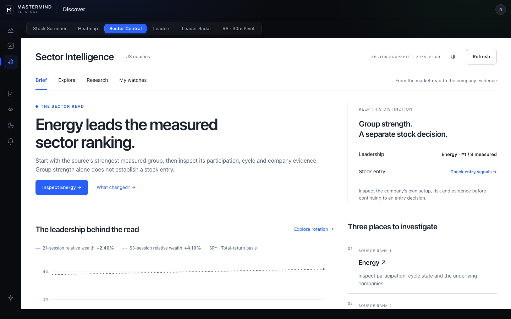
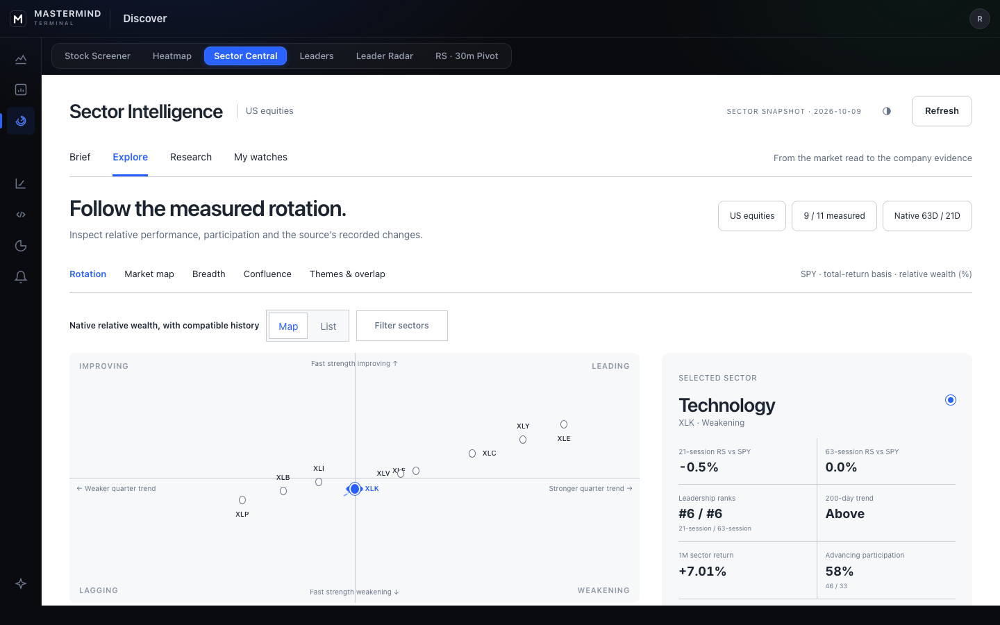

# Sector Central — Paper R2 review packet

This packet contains first-party Paper designs and screenshots of the actual native Terminal implementation. It is part of the delivery under operation `sector-paper-r2-frontend-20261018-sol-001`.

[Build plan and remaining integrations](../../SECTOR_CENTRAL_PAPER_R2_BUILD_PLAN_2026-10-19.md) · [P0 research proposal](../../SECTOR_ROTATION_P0_FEASIBILITY_PROPOSAL_2026-10-19.md) · [actual Paper page](https://app.paper.design/file/01M2WGNCX9475G79JRKJTCM08P/p-Y-0)

## Design authority

- Original R2: [Brief](paper-r2-brief.jpg), [Rotation](paper-r2-rotation.jpg).
- Actual native variants created in Paper: [Brief — 6K0C-0](paper-native-brief.jpg), [Rotation — 6JVY-0](paper-native-rotation.jpg).
- The original concept illustrations and the native browser fixture use different illustrative dates/groups. Their values are not production observations. Native variants explicitly use the existing 21/63-session relative-wealth measurement.
- Decorative container-edge rails were removed; the permanent instruction is in both AGENTS files.

## Actual native browser output





Every row below has all three contract viewports. These files are unedited browser captures.

| State | Desktop 1440×900 | Tablet 820×1180 | Mobile 390×844 |
|---|---|---|---|
| Brief | [open](brief-light-en-desktop.png) | [open](brief-light-en-tablet.png) | [open](brief-light-en-mobile.png) |
| History/value table | [open](brief-history-light-en-desktop.png) | [open](brief-history-light-en-tablet.png) | [open](brief-history-light-en-mobile.png) |
| Rotation | [open](rotation-light-en-desktop.png) | [open](rotation-light-en-tablet.png) | [open](rotation-light-en-mobile.png) |
| Market map | [open](market-map-light-en-desktop.png) | [open](market-map-light-en-tablet.png) | [open](market-map-light-en-mobile.png) |
| Breadth | [open](breadth-light-en-desktop.png) | [open](breadth-light-en-tablet.png) | [open](breadth-light-en-mobile.png) |
| Dossier | [open](dossier-light-en-desktop.png) | [open](dossier-light-en-tablet.png) | [open](dossier-light-en-mobile.png) |
| Research | [open](research-light-en-desktop.png) | [open](research-light-en-tablet.png) | [open](research-light-en-mobile.png) |
| Confluence | [open](confluence-light-en-desktop.png) | [open](confluence-light-en-tablet.png) | [open](confluence-light-en-mobile.png) |
| Themes | [open](themes-light-en-desktop.png) | [open](themes-light-en-tablet.png) | [open](themes-light-en-mobile.png) |
| My watches | [open](watches-light-en-desktop.png) | [open](watches-light-en-tablet.png) | [open](watches-light-en-mobile.png) |
| Saved named list | [open](watches-saved-light-en-desktop.png) | [open](watches-saved-light-en-tablet.png) | [open](watches-saved-light-en-mobile.png) |
| Sources | [open](sources-light-en-desktop.png) | [open](sources-light-en-tablet.png) | [open](sources-light-en-mobile.png) |
| Missing history | [open](brief-missing-history-light-en-desktop.png) | [open](brief-missing-history-light-en-tablet.png) | [open](brief-missing-history-light-en-mobile.png) |
| Access lost | [open](brief-access-light-en-desktop.png) | [open](brief-access-light-en-tablet.png) | [open](brief-access-light-en-mobile.png) |
| Chinese + dark Brief | [open](brief-dark-zh-desktop.png) | [open](brief-dark-zh-tablet.png) | [open](brief-dark-zh-mobile.png) |

## Verification evidence

Candidate base: `367f488e5c67d0871d4a34c2aa7371f327d44c3d`.

The [source manifest](candidate-working-tree.json) binds the 28 changed source paths to SHA-256 `7208dca61ed1a629a26509d6c8dfe7f50dbaaa5d68529ca3d0be476cdfd8c61f`. Documentation/captures are excluded from that digest. The [capture manifest](capture-manifest.json) binds the 49 image files separately.

| Check | Observed result | Receipt |
|---|---|---|
| Paper and existing rotation/measured/navigation unit tests | 126/126 passed | [output](unit-paper.log) |
| Native Sector browser suites | 57/57 passed: 19 journeys × 3 viewports | [output](browser-sector-57.log) |
| TypeScript | exit 0 | [output](typecheck.log) |
| Changed-source ESLint | exit 0 | [output](eslint.log) |
| Forward-only plain-language guard | exit 0; self-check also passed | [output](plain-language.log) |

The final 57-case run and all 126 relevant unit tests passed after the language-dictionary and presentation-class corrections on the manifest-bound source. The browser run includes all 45 native captures. Repeated diagnostic runs are not counted as additional unique tests. The full repository unit and hosted browser suites remain separate CI gates.

The canonical scoped browser command was:

```sh
CI=1 TERMINAL_E2E_PORT=3179 npm run test:e2e:responsive -- \
  e2e/sector-paper-workspace.spec.ts \
  e2e/sector-company-workflow.spec.ts \
  e2e/sector-group-discovery.spec.ts \
  --project=desktop --project=tablet --project=mobile \
  --workers=1 --retries=0 --reporter=line
```

Unit verification used the four new `sectorPaper*` test files plus existing `sectorRotationMap`, `sectorMeasuredRead` and `sectorAmalgamationNavigation` tests. TypeScript used `tsc --noEmit --incremental false`; ESLint covered the changed Paper components/model/copy, shared dictionary, native controller and browser spec. Retained outputs are observations from Studio Direct, not reconstructed test transcripts.

Independent C3 source reviews accepted the measurement qualifications, missing-secondary-value handling, unmeasured names/reasons, Confluence's source-specific stale notice, native mount, feed isolation, lens/native consistency and per-entry dossier return origin. Runtime, watchlist and production acceptance are not attributed to those reviewers.

The browser proof uses the normal repository development server and existing isolated fixtures. Market values are dated or synthetic. My watches exercises the existing API/service and isolated fixture database, with the existing signed-in shell opt-in. Production Supabase, actual customer data, deployment and complete hosted CI are outside this local proof.
