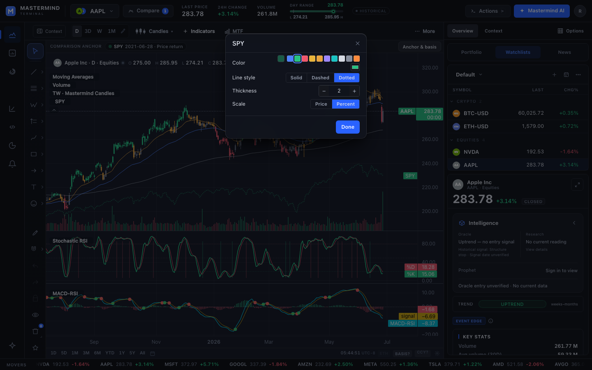
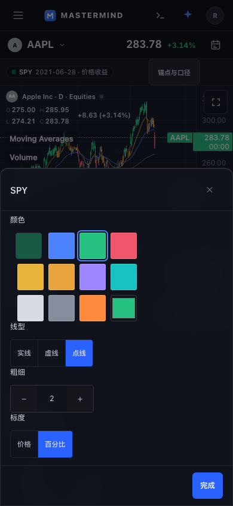

# Comparison settings interaction proof

## Outcome

Comparison settings now use the established native chart-settings dialog lifecycle. Keyboard focus stays inside the dialog, Escape / Close / Done dismiss it, and focus returns to the comparison's existing legend action. Color changes retain the saved opacity and other comparison terms. Controls expose names, selected states, and thickness bounds. Scoped styles wrap the color and scale rows at phone width and retain the incumbent chart visual language.

## Provenance

- Authorized mission: continue Terminal UI/UX polish and enroll qualified Ready changes in the existing auto-merge flow without waiting for the queue.
- Procedure pin: `ff6d5ab67c3535056d69f603fac0d95c058baad8`; design doctrine pin: `536ab7d78c2fbcab8a7c8a3cdc8d09fbe2bff136`.
- Protected source base: `1c0bf028cf72539a4d3fcb17fa137ee474d764f9`.
- Product and test head qualified: `236c5c28db3d0bd545cd3f7c4e0cd841f9ca664d`.
- The isolated Next 16.2.9 / React 19 fixture copy verified 3,378 source/config/test files against that base plus this candidate, with zero mismatches.
- Paper Terminal file `01M3NSZGE8JWN2EZCSF0DT05RM`, D06 R2 chart board `1U01-0`, was inspected as a design reference. This bounded dialog change does not certify whole-workspace Paper parity.
- Source publication uses the GitHub connector. The isolated validation copy has no Git writer.

## Verification

- Five new mounted interaction tests fail against the old comparison dialog and pass after the change.
- Final affected unit command: `vitest run lib/__tests__/compareSettingsAccessibility.test.tsx lib/__tests__/chartSettingsUi.test.ts lib/__tests__/compareAnchor.test.ts`: **90 passed**.
- Changed TSX and browser spec ESLint: **exit 0**, no findings.
- TypeScript: `node --max-old-space-size=6144 node_modules/typescript/bin/tsc --noEmit --incremental false`: **exit 0**. An earlier default-heap attempt exhausted its 2 GB heap; the source was not changed to accommodate it.
- Playwright against unchanged Turbopack and the incumbent local fixture owner: **6 passed, 0 retries, 0 skips** across desktop 1440×900, tablet 820×1180, and phone 390×844 in English and Chinese.
- Browser assertions cover actual dialog focus, Tab wrap, key ownership, RGB value and retained 0.4 alpha in the real comparison storage, live style selection, reopening, restored body overflow, desktop legend focus restoration, no dialog overflow, and at least 44px coarse-pointer control height.
- The first browser pass exposed a real desktop legend focus-return defect plus English-only test selectors. The corrected source and localized selectors were rerun across the entire six-case matrix; see the final log.
- Desktop English and phone Chinese captures were visually inspected. The phone sheet contains all controls and Done within the viewport.

## Scope and delivery truth

Comparison state ownership, anchor semantics, chart engine, and release controls remain with their existing owners. These are isolated consumer/browser proofs, not a claim of production deployment or production account acceptance. Native CI, CODEOWNERS and merge/release requirements still apply; the PR will request only the existing merge-on-green path.

## Captures

## Source Git blob hashes

- `terminal/components/CompareSettings.tsx`: `610a69d77309b1b6f72b06b75a48853cf1bee030`
- `terminal/components/CompareSettings.module.css`: `6b5127851b05f5c47f619392fc2a931cbaea2d7c`
- `terminal/lib/__tests__/compareSettingsAccessibility.test.tsx`: `ae17ab0119cd67e27c09501346a82d0d1bcfc02b`
- `terminal/e2e/comparison-settings-polish.spec.ts`: `9c0570330d83bf1660a5e46cb217e32a372e2a59`
