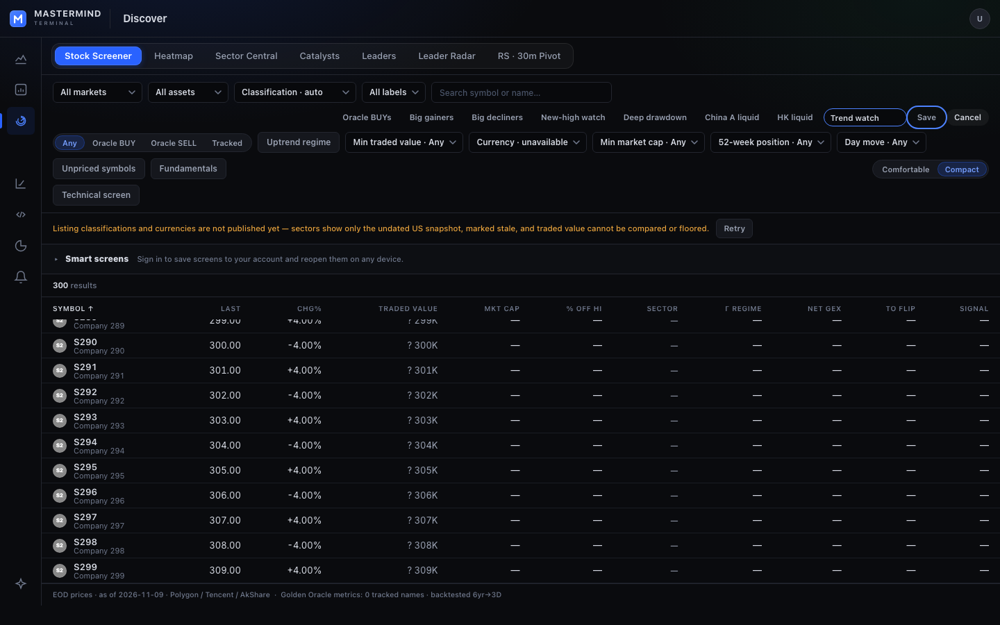
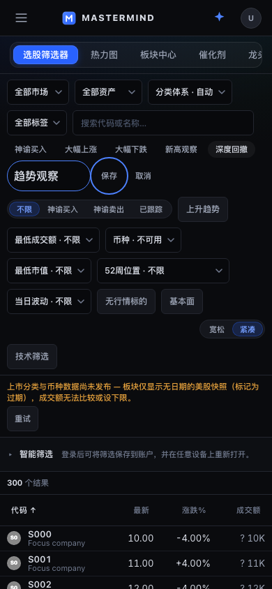

# Screener interaction continuity proof

## User-visible changes

A deeply scrolled desktop result list could show no rows after filtering to a smaller matching set: its virtual slice started beyond the new result count. Intentional search, sort, market/filter and technical-screen changes now reveal the first result; background data refreshes preserve the reading position. Virtual bounds also recover if a background result set shrinks. Density changes preserve the prior row anchor, with a separate end-of-list rule that keeps the final row visible.

Sort headers now contain full-width native buttons, including the original padding hit area and 44px coarse-pointer height. Ticker identities are canonical native links; the row convenience click yields to links, nested evidence controls and modified clicks.

Preset names remain editable while focus moves. Visible Save and Cancel actions support pointer, keyboard and IME entry. Save/Cancel returns focus only when the removed editor owned it. Failed saves keep the retained draft focused and keep the established direct Tab path to Retry; existing acknowledged-storage and retry semantics remain unchanged.

## Provenance

- Authorized Terminal UI/UX continuation; original protected checks and merge queue remain in force.
- Procedure pin `ff6d5ab67c3535056d69f603fac0d95c058baad8`; design pin `536ab7d78c2fbcab8a7c8a3cdc8d09fbe2bff136`.
- Base `1c0bf028cf72539a4d3fcb17fa137ee474d764f9`.
- Product/test head `b9978b95292cca5e1670f341373af27f0387c392`.
- Isolated Next/React fixture consumer verified 3,378 source/config/test files with zero mismatches; the comparison candidate was removed before this run.
- No new data or preference owner, production mutation, or routing authority was added.

## Verification

- The pre-change mounted view fails three of four new continuity cases: filtered results, shrinking background results, and native sort/link semantics. The same-universe background refresh case already passes and remains a protected behavior.
- **42 affected mounted tests passed**: four continuity tests plus 38 preset persistence/editor tests. They also passed in the final 87-test combined run, whose other 45 tests qualify the separate chart shortcut change.
- TypeScript `node --max-old-space-size=6144 node_modules/typescript/bin/tsc --noEmit --incremental false`: exit 0.
- ESLint adds no finding: ScreenerView has the same nine existing errors as the exact preimage; all four changed/new test files are clean. This is not a claim that the legacy view is globally lint-clean.
- **18 Playwright journeys passed, 0 retries, 0 skips**, English and Chinese at 1440×900, 820×1180 and 390×844.
- Desktop uses the existing nested virtual scroller; ≤860px uses the existing document-scrolling shell. The browser journeys exercise each actual scroll owner, without changing that layout contract.
- Desktop proof includes deep → two results → empty → clear, full header hit area, keyboard sorting, mid-list density preservation, and the final result remaining visible through both density directions.
- All viewports prove native ticker href/keyboard navigation, visible Save/Cancel, composition safety, focus return, no horizontal overflow and coarse-pointer targets. Twelve recovery journeys retain the previous storage-denial/read-denial/retry/delete contracts; the failed-save path now starts from the visible Save button.
- The first responsive run assumed desktop nested scrolling on small layouts. Its four failures were test assumptions; the final test follows the existing document owner. Product source was not weakened for that correction.
- Desktop English and phone Chinese captures were inspected. Market values are explicit synthetic fixture data; unavailable classification/currency is intentionally rendered as unavailable.

## Delivery truth

This is qualified source and isolated browser proof, not production release acceptance. The Ready PR is eligible to request the existing merge-on-green flow; native CI/CODEOWNERS/release requirements remain authoritative.

## Source Git blob hashes

- `terminal/components/ScreenerView.tsx`: `1363bf6c973083a6594c8e826c24c2b8664377ef`
- `terminal/components/ScreenerInteractions.module.css`: `08364eecd200d9b3da09175ae5fe46357a4407ca`
- `terminal/lib/__tests__/screenerInteractionContinuity.test.tsx`: `6c38ee587102e230ab890ffd84d5d03557ba07b3`
- `terminal/lib/__tests__/screenerPresetPersistence.test.tsx`: `9d9bbf22449dadcfe34074459e04ecf6343d5b2d`
- `terminal/e2e/screener-interaction-continuity.spec.ts`: `a9ab28803fcab22f6a95d1e85f014bb8887c7af1`
- `terminal/e2e/screener-preset-persistence.spec.ts`: `460b1b22e8ae28f146f77fbd1bddfacae4ec4d52`
