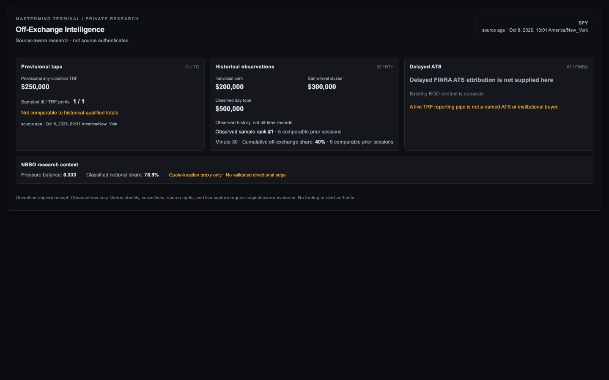
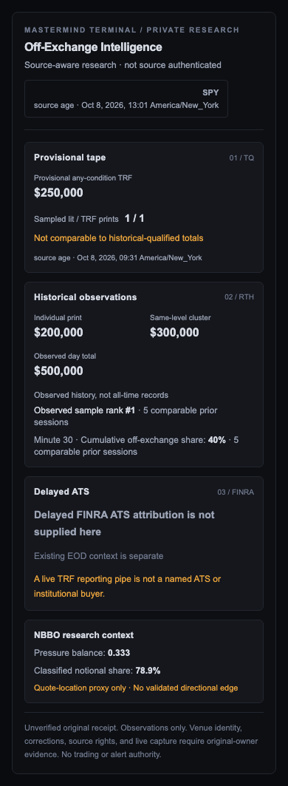

# Terminal TP-2 private off-exchange decoder — Phase A

**Date:** October 12, 2026 (UTC)
**Role:** Terminal issue [#655](https://github.com/mastermindx-market-intelligence/mastermind-terminal/issues/655), implementing an independent *read-only/private* consumer contract under Massive TP parent [Macro #7367](https://github.com/mastermindx-market-intelligence/macro/issues/7367).
**Status:** **BUILT_NOT_PROVEN / not released**. No source subscription, R2 fetch/publisher, entitlement, API route, client-side import, browser product, chart marker, trade signal, or deployment.

## Pins and source ownership

- Terminal current master at source acquisition: `e0c405a09b6897df3b5e4a2f22344f3560b800a4`. Terminal [TP1/R0 lossless private decoder PR #915](https://github.com/mastermindx-market-intelligence/mastermind-terminal/pull/915) **already merged** as `c923cc46d179dd92cb6e3bd6d10c03c9bac17c76`. Its `terminal/lib/tp1PrivateEvidence.ts` and `terminal/lib/tp1Nanoseconds.ts` retain custody of original TP1/R0 private source v0 bytes and nano clocks. Do not replace either reader.
- Macro [TP-2 source-free draft PR #8859](https://github.com/mastermindx-market-intelligence/macro/pull/8859), exact observed head `4feec92aa350f4300e0cb60b63aabbafb5c87801`, owns `engine/tp2_private_ruler_view.py` and its **derived-view** canonical serializer/readback. This is **not** a live source or production R2 store.
- Macro [TP-B research draft #8784](https://github.com/mastermindx-market-intelligence/macro/pull/8784) owns original historical ruler source; TP1 [#8660](https://github.com/mastermindx-market-intelligence/macro/pull/8660) owns the single candidate trade/quote feed; Macro R0 [#8659](https://github.com/mastermindx-market-intelligence/macro/pull/8659) merged as `7cb33d3aaac3512bee53d7254a785af38f3bd172`. All source/auth/receipt/correction decisions stay with those owners.
- Protected Mastermind procedure pin: `25c4b7923734392b1013afae179966985819d847`, compatible `mastermind.sol_skillpack.v1/1.0.1/bootstrap_major=1`; protected INDEX blob `339c3d810f8c74ec157a793b143fde9aeb1e4fec`. Same-commit required universal companion procedures read.

## What the new pure private decoder does

`terminal/lib/tp2PrivateEvidence.ts` exports two separate **server-only** readback projections:

- `decodeTp2PrivateArtifact({bytes,expectedSha256,expectedLength,requestedAsOfNs})`: reads the exact, original **derived-view** source schema `darkpool.tp2_private_offexchange_view/v0`. Enforces a 64 KiB maximum, the original expected digest and byte length, Python-compatible sorted-key canonical ASCII JSON (one LF), exact known top/nested allowlists, and no source/authority promotion. Returns `terminal.tp2.private_projection/v0`.
- `decodeTp2R0Sidecar(...)`: reads the separately versioned **observational** `darkpool.tp2_r0_observed_research/v0` with a 24 KiB maximum and identical byte/cutoff validation, without mixing its quote-location proxy ratios into TP1/TP-B measurements. Returns `terminal.tp2.r0_research_projection/v0`. This is not a second R0 original byte decoder or source signer.

Both use the **existing** `parseUnsignedNanoseconds` from `tp1Nanoseconds.ts` to preserve 19-digit Unix nanoseconds as `bigint`, not JS `Number`. A viewer cutoff earlier than the artifact's original `view_asof_ns_decimal` refuses. The original RTH date and available 9:30 a.m. America/New_York clock are checked with DST-aware `Intl`, but the external market-calendar/source owner must still prove actual trading days, early closes and original custody. Source-manifest and generation hashes identify only supplied internal content, **not vendor signatures**.

Any permitted source view remains `sourceAuthenticated=false`, `publicDeliveryAllowed=false`, `productionApproved=false`, `tradingAuthority=false`, with no signal, live block tape, price shelves, signed aggressor flow, or named ATS attribution. The current EOD/weekly FINRA consumer is **unchanged** and separately labeled. Null source and history states remain null, never market-zero or a fabricated record.

Three observational grains stay separate: largest **single print**, largest **same-level 60s cluster**, and qualified **RTH sampled total**. Sample ranks retain `priorN` and **rank in observed comparable history**, never an all-time or trading signal claim. The historical intraday baseline matches **exact RTH minute index** and keeps null z-score/zero-MAD states. TP1's `provisional_trf_any_condition_notional_usd` and TP-B's `measured_rth_trf_notional_usd` are **not added or source-joined**: provisional raw sale eligibility, final-vintage corrections, consolidated denominators and receipt clocks are different. R0 pressure/response remains an **independent descriptive quote-location proxy**, not a validated predictor, native aggressor or order-book absorption label.

No fetch, writer, background process, R2 bucket selection, tenant-authorizer, React page, chart renderer, authenticated service or deployment was created. The `node:crypto` dependency makes the consumer a server-side pure function, not a browser data loader.

## Immutable Macro-generated evidence

Exact fixture bytes are copied unmodified from Macro at the stated source pin, not recreated by hand in the Terminal repo:

| Fixture | Native Macro schema | Length | SHA-256 |
| --- | --- | ---: | --- |
| `terminal/lib/__tests__/fixtures/tp2PrivateView.synthetic.v0.json` | `darkpool.tp2_private_offexchange_view/v0` | **3,394** | `8c1ee4f865566f013d7a5805fccdd11c031223d39c6d8ec6b66968cbdc35f60b` |
| `terminal/lib/__tests__/fixtures/tp2R0Sidecar.synthetic.v0.json` | `darkpool.tp2_r0_observed_research/v0` | **1,541** | `fe03401a908d26230aa6f8426f9dd9318249a0cdd2eac256ed93786a0a48b715` |

The first shows synthetic TP1 provisional TRF notional **$250,000** separate from TP-B observational daily TRF notional **$500,000**, 3 distinct historical-grain rank states, and an exact-minute cumulative share `0.4` with prior N=5. The second contains an R0 observed pressure-balance proxy `0.3333333333333333333333333333` and explicitly false calibration/actor-truth claims. All inputs and their original purported receipts are **constructed synthetic data**, with no licensed real Massive tape, private source credentials or market completeness.

## Fixture-only server-side readout (NOT an authenticated browser page)

The additive `terminal/components/offexchange/Tp2ResearchReadout.tsx` is a **server-rendered, no-route/no-fetch/no-client-state** private presentation candidate that consumes already verified `Tp2PrivateProjection` and optional separate `Tp2R0Projection`. It requires an explicit `privateViewAuthorized` presentation guard. When false it renders **no ticker, notional, source digest or private observations**. This guard is **not an authentication implementation**: the ORIGINAL Terminal server/service/tenant access owner must verify authorization before constructing or passing market evidence, and the component remains unmounted until that service is approved.

The readout uses Mastermind's existing `--panel`, `--line`, `--text`, `--muted` and `--font-num` tokens and Tailwind responsive one/three-column layout, with English/Chinese source-maturity text and accessible labeled sections. Correction-stale history, calibration pending, and partial-session no-daily-rank are **distinct visible states**, not quiet/zero market interpretations. Its three lanes keep (1) **provisional TP1 raw sampled TRF** distinctly unqualified, (2) separate **TP-B individual print / same-level cluster / observed RTH total** with observed historical rank N and exact-minute context, and (3) **delayed FINRA ATS not available in this source** beside the existing independent EOD context. A separate R0 research row shows descriptive NBBO quote-location pressure only when the TP-2 view supplies a **non-null matching ticker and session** and the R0 evidence is no later than the TP-2 as-of; otherwise the R0 proxy is withheld. An absent TP-2 identity cannot anchor an otherwise plausible R0 sidecar, even if the latter independently includes original source receipts. Money and cumulative fraction display uses bounded **exact `BigInt` string formatting** rather than `Number` arithmetic. Visual screenshot review identified overlong R0 proxy fractions in desktop/mobile cards; the readout now shows **concise exact-integer-rounded** research figures (example pressure `0.333`, classified coverage `78.9%`) while retaining the complete original source decimals in `title` tooltips and the untouched decoder payload. Tiny positive coverage uses `<0.1%`, and sub-100% near-complete coverage uses `>99.9%` rather than falsely displaying exact zero or complete 100%. This is a display-only formatter, not source quantization or signal validation. Milliseconds are derived from nanoseconds only for the human-readable timezone stamp, never fed into the source-as-of admission.

`terminal/lib/__tests__/tp2ResearchReadout.test.ts` contains **18 pure SSR tests**: gated source non-disclosure, metric-grain distinction and no $250k+$500k summation, observed history sample counts, Chinese/English copy, delayed ATS absence, source-unavailable not equal to market-zero, mismatched R0 withholding, responsive theme classes and absence of fake actions/vendor URLs. An initial test-only assertion mistakenly matched the negated Chinese disclosure "not an institutional buyer"; it was corrected after direct markup inspection. The corrected one-worker suite passed **18/18**. This validates React HTML semantics and source honesty, **not** real browser layout, source-licensed data, responsive interaction or production deployment. No per-print chart markers, absorption claims or recurring-price shelves are rendered because upstream original data is absent.

## Offline headless Chromium responsive fixture evidence (not production)

The additive reproducible offline check `terminal/scripts/verify-tp2-readout-browser.mjs` compiles this **actual server component and decoder** using the already-installed `esbuild`, builds its real Tailwind utility classes with `@tailwindcss/postcss`, and uses installed Playwright **Chromium 149.0.7827.55** to render the two original SHA-pinned Macro synthetic private artifacts. It neither launches the Terminal app nor contacts any URL, credential, R2 bucket, data provider or backend. Temporary compilation files are scoped to a fresh local directory and deleted in `finally`.

**PASS:** ten responsive/language/palette scenarios (390px mobile, 768px tablet, 1440px desktop; English/Chinese, dark/experimental-light tokens). Real Chromium computed **one column below lg, three columns at desktop**, no horizontal document overflow, retained source-separated $250k/$500k observations without a false sum, and computed readable foreground/panel contrast of **13.7–16.35:1** for this fixture's shell. The private-authorization-false DOM withheld ticker, original notional and proxy values. Five additional rendered fixture states passed: no source, corrected historical calibration stale, partial RTH daily rank suppression, mismatched-symbol R0 withheld and Chinese corrected-state copy. The **light palette is simulated token compatibility**: Terminal's current application styles are dark-only. This fixture-only browser test is **not** a production route, actual mobile device test, screen-reader certification, licensed source proof, real auth, current market evidence, or an authenticated browser session with end-to-end live TP1/R2.

The following two **synthetic fixture-only** screenshots were inspected in Chromium after the compact exact-decimal presentation repair. They demonstrate a source-free visual review at the recorded widths, **not an authorized market-data screen, production installation or authenticated app browser proof**. They are deliberately kept inside this draft's design/acceptance documentation rather than a public runtime asset path:





Source screenshots: desktop SHA256 `4cce3f1575180b0afdccaee6505d2b580646d591ee205892704a1f3f9d004b8e`; mobile SHA256 `6a5c5cf4c49d32ed221744aa7c1001a8b039926fbf8f2392fee84e14b55a393a`. Their input TP-2/R0 JSON fixture digests are recorded in the table above. No live data, names of ATS participants, native trade IDs or credentials appear.

Run from `terminal/`:

```sh
node scripts/verify-tp2-readout-browser.mjs
# Optional local screenshots only (never publish as real-market evidence):
TP2_BROWSER_SCREENSHOT_DIR="$PWD/.tp2-review-visual" node scripts/verify-tp2-readout-browser.mjs
```

## Verification and next implementation owner

Run from `terminal/` on an isolated source checkout:

```sh
./node_modules/.bin/vitest run lib/__tests__/tp2PrivateEvidence.test.ts lib/__tests__/tp2ResearchReadout.test.ts lib/__tests__/tp1Nanoseconds.test.ts lib/__tests__/tp1PrivateEvidence.test.ts --pool=forks --maxWorkers=1 --minWorkers=1
./node_modules/.bin/tsc --noEmit --strict --target ES2017 --lib dom,dom.iterable,esnext --module ESNext --moduleResolution bundler --jsx react-jsx --esModuleInterop --types node --skipLibCheck lib/tp1Nanoseconds.ts lib/tp2PrivateEvidence.ts components/offexchange/Tp2ResearchReadout.tsx lib/__tests__/tp2ResearchReadout.test.ts
./node_modules/.bin/eslint lib/tp2PrivateEvidence.ts lib/__tests__/tp2PrivateEvidence.test.ts components/offexchange/Tp2ResearchReadout.tsx lib/__tests__/tp2ResearchReadout.test.ts --max-warnings=0
```

At the readout implementation candidate, **44 source-private TP-2 decoder tests, 18 server-rendered readout tests, and 124 combined Terminal TP1/R0/TP-2 tests** passed. After hosted CI on the initial decoder commit flagged ES2017-incompatible `123n` literal syntax, all new literal expressions were replaced with exact `BigInt()` constructor calls (long nanosecond values passed as decimal strings); the source/test/readout then passed local **ES2017-targeted strict TypeScript**, preserving exact BigInt arithmetic without changing the project's tsconfig or protected workflows. That original hosted run also failed an unrelated tablet live-bar-burst E2E case; TP-2 did not change the chart test or candle engine. Strict TypeScript and zero-error ESLint passed. The React readout remains fixture-only and unmounted, not a real-data browser acceptance. Tests include original Python-byte fixture parity, missing/stale/future states, nanosecond exactness, duplicate JSON keys, original SHA and length mismatch, recomputed-hash tampering, forged live/ATS/trading/publisher claims, timestamp/session mismatches, separate TRF numerators, exact historical ranks and R0 observational-only projection. Sparse test dependency symlink uses an already-installed Node dependency tree; **no packages installed or source paths altered outside the isolated worktree**.

For the successor Terminal #655 owner, the next product work is **actual sanctioned private-source service integration, stateful responsive browser evaluation, and chart overlays only where original print-level evidence is available**; the static fixture-only readout and source-private schema cannot substitute for those proofs. Keep three major surfaces distinct: *Live Off-Exchange (provisional until TP1 audited source)*, *History/Analogs (TP-B observed coverage only)* and *Delayed FINRA ATS context (separate EOD origin and report clock)*. Source absent, stale, corrected, withheld or partial states must be glanceable, with bilingual/dark/light/mobile and replay checks. No actual per-print block marker or shelf can be drawn from a source-free aggregate; each requires original source-owned individual print/shelf provenance.

The major gates remain: CI-policy owner approval for Macro TP1/TP-B/TP2 suites (prior protected YAML attempt explicitly denied), original Quote Hub singleton access/live 99%/95%/2% RTH evidence, original licensed historical LIST-and-budget-before-GET, correction/venue/condition/split/calendar data rights and receipts, and an approved private market-data R2 namespace plus tenant entitlement. **Generic public R2 and the separately credentialed Research Vault are not automatically authorized for TP2.** No Vercel, no merge/deploy/published endpoint from this Phase A. Current Terminal decoder implementation itself may be eligible for review/CI merge independently of live source, but is not a deployed product acceptance receipt.

**Status: BUILT_NOT_PROVEN.**
