# Private Company Intelligence — isolated component evidence

The images and manifest below retain the earlier v1 source evidence. The current timing-v2 source and dated disclosure captures are documented in [v2/EVIDENCE.md](v2/EVIDENCE.md).

These captures render the actual new presenter source with explicitly synthetic inputs. They do not establish production integration, account access, C01 admission, live private facts or light-mode availability.

The browser receipt covers 24 layout cases, 132 transitions away from READY, preserved full hashes and strings, contained native controls, no horizontal document/panel overflow, and visible 2px keyboard focus. The source is pinned by file hashes in `manifest.json`.

The standalone harness does not run the Next font loader; it supplies the existing `--font-inter` font-family name so the shared native fallback stack resolves. Light captures use the existing reference study aliases only. Both limitations are visible in every image.

Source review accepted the isolated presenter and controller increment. All 205 focused tests pass: 57 decoder, 55 route, 64 controller, 22 presenter and 7 wrapper tests. TypeScript noEmit and scoped ESLint exit 0. Controller tests include the actual wrapper, presenter and decoders, the single 10-second initial deadline, superseded input/fact responses and callbacks, discarded-render preservation, and best-effort stream cancellation. These are source and synthetic integration checks. The browser captures below exercise the presenter with synthetic inputs; host integration and complete user-flow acceptance remain separate gates.

## Ready state — synthetic component

### 1440px / EN / dark

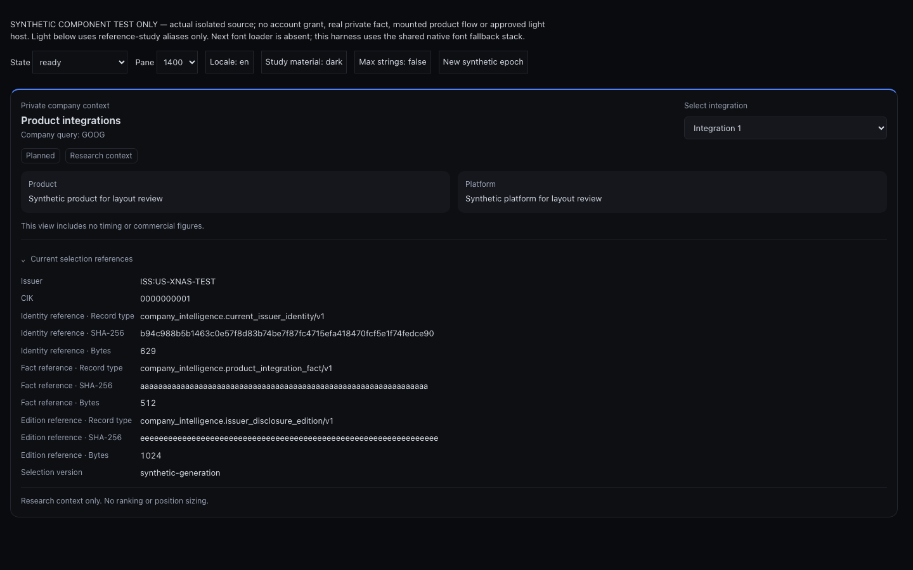

### 1440px / EN / light reference study

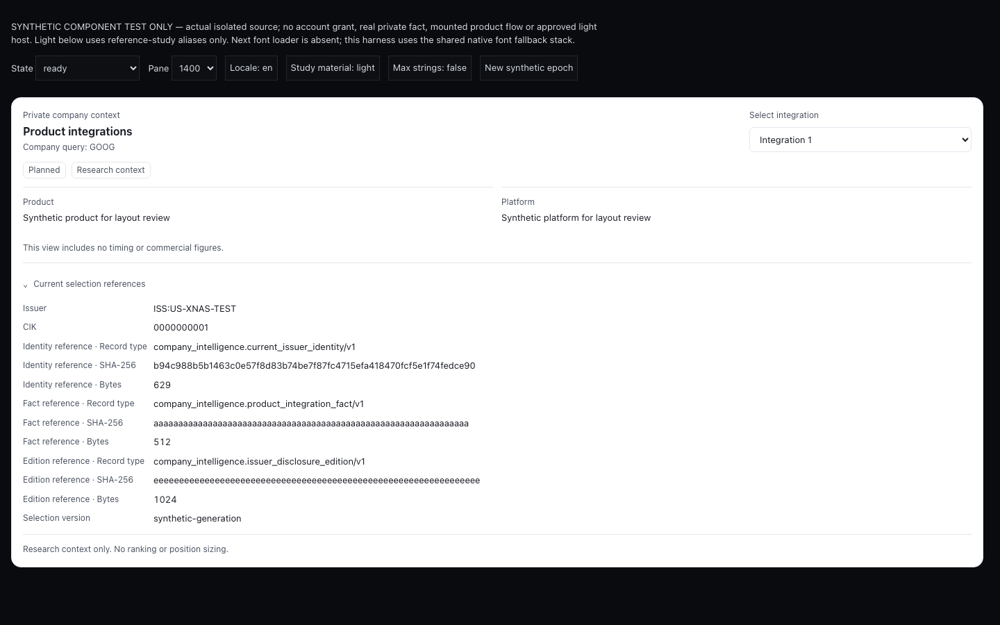

### 1440px / ZH / dark

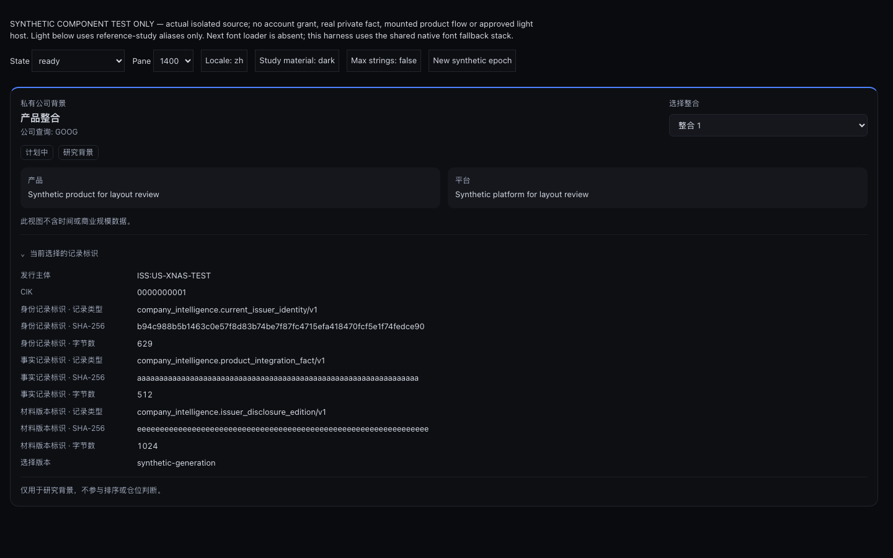

### 1440px / ZH / light reference study

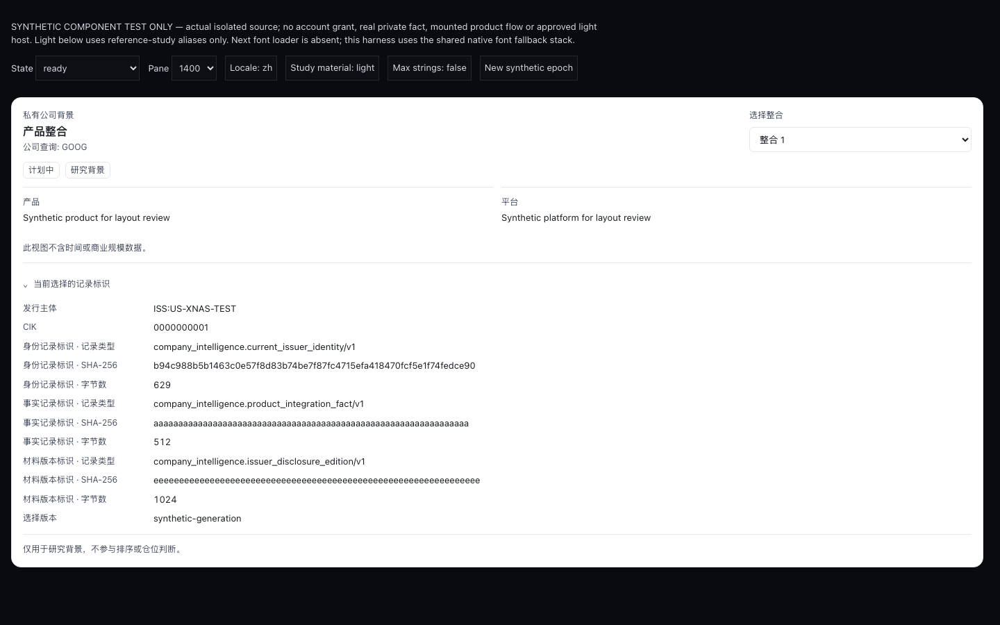

### 820px / EN / dark

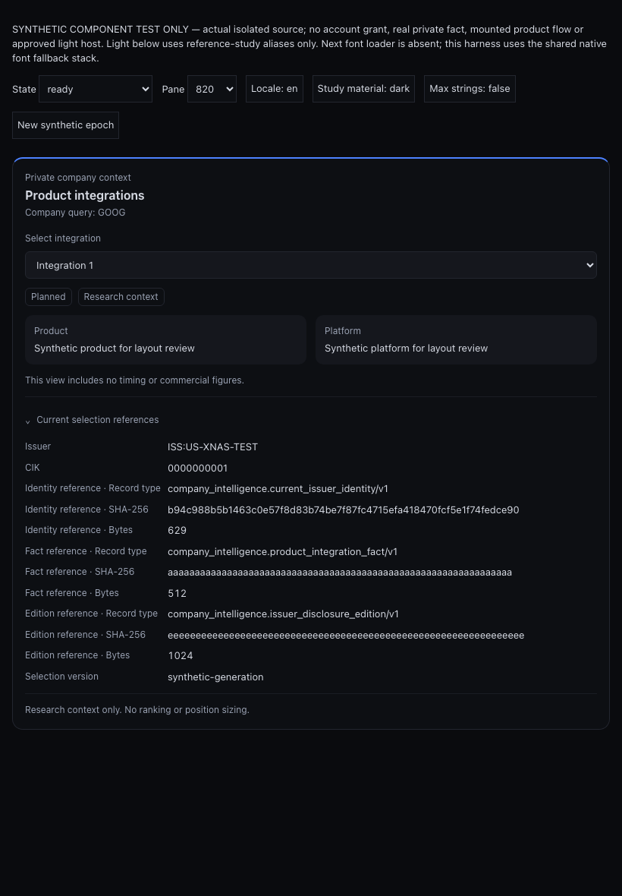

### 820px / EN / light reference study

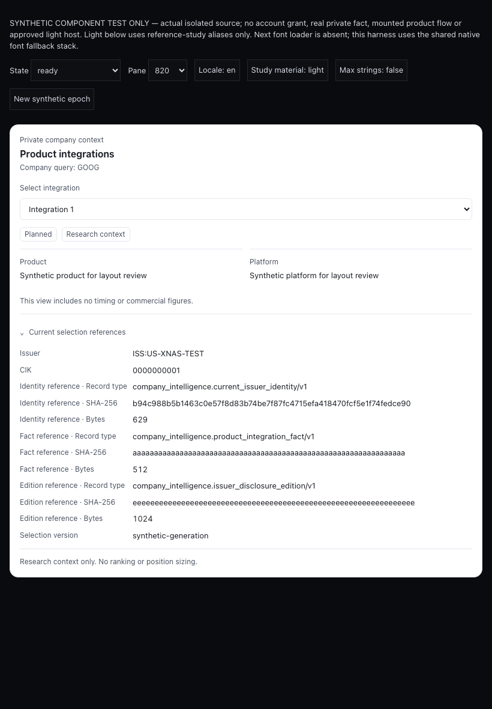

### 820px / ZH / dark

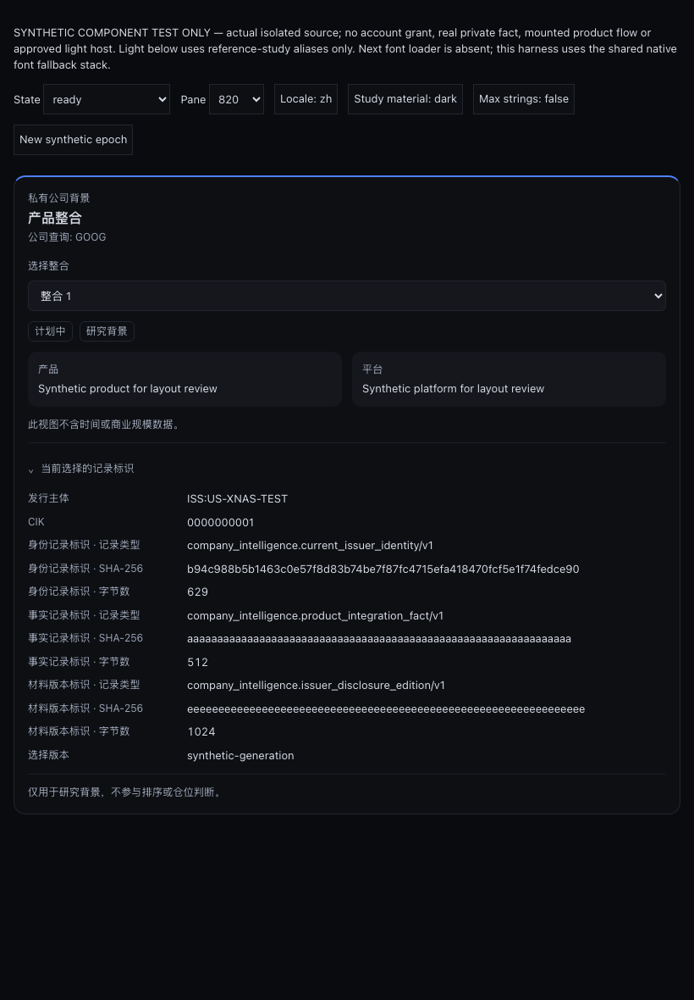

### 820px / ZH / light reference study

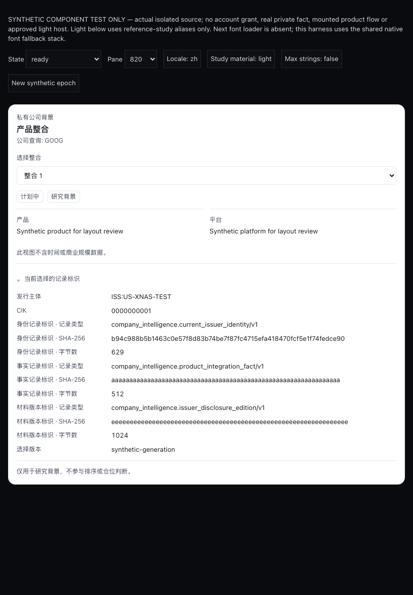

### 390px / EN / dark

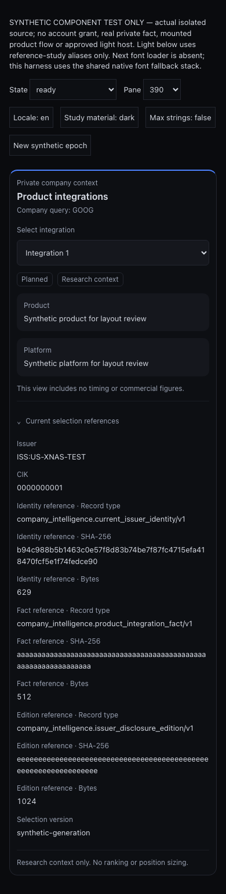

### 390px / EN / light reference study

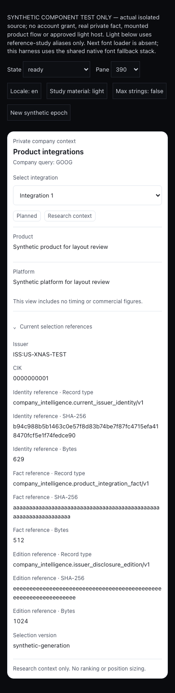

### 390px / ZH / dark

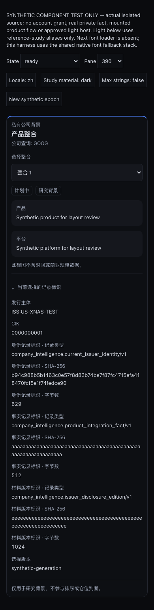

### 390px / ZH / light reference study

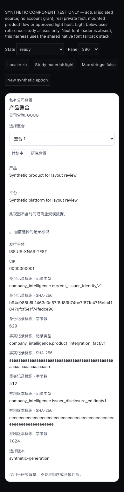

## Constrained pane and focus checks

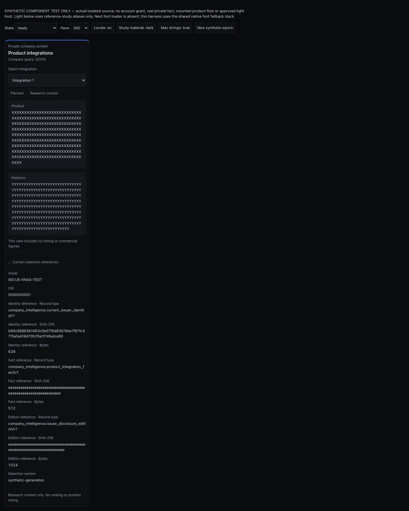

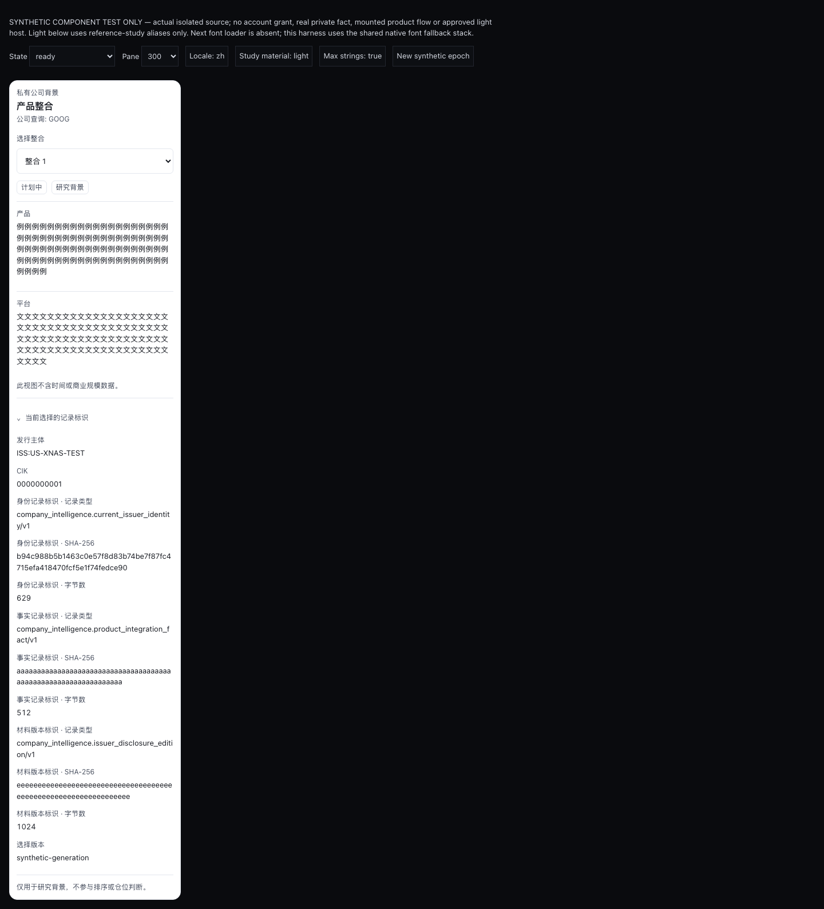

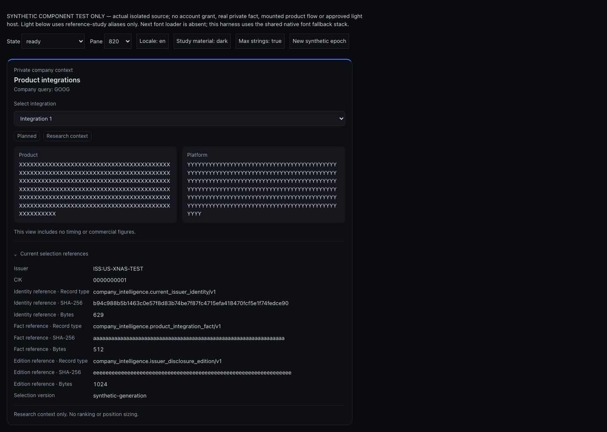

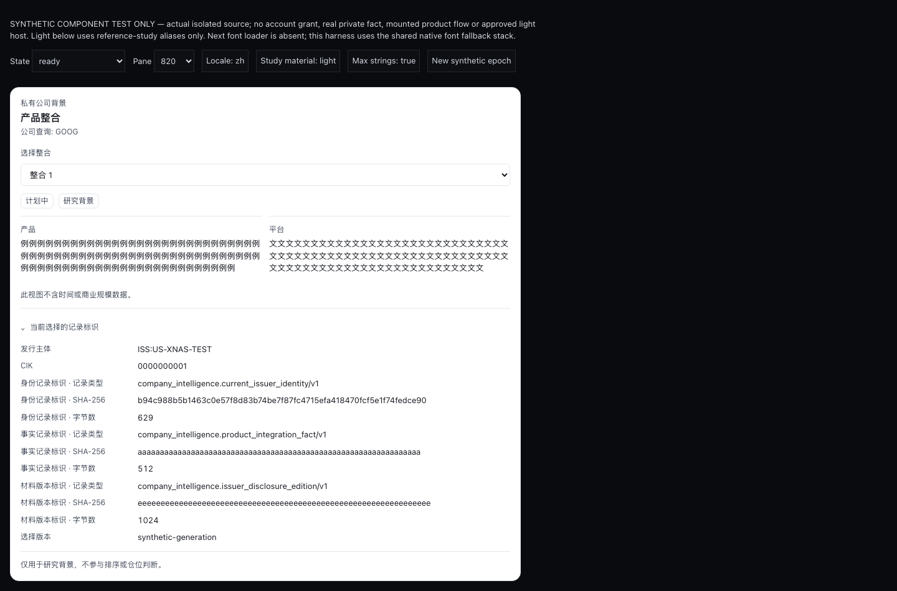

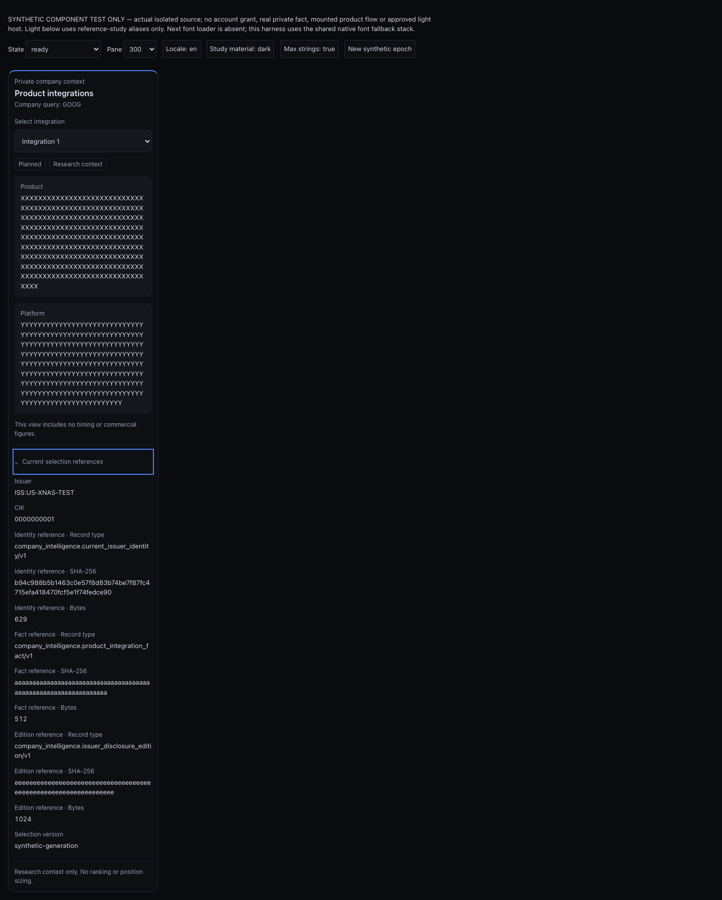

## Open acceptance obligations

The real intelligence host mount requires incumbent shared-file custody. Its caught-error reporter, actual theme path and source/entitlement lifecycle must be qualified. The complete flow still needs source-backed facts, approved account access, designated visual acceptance, 200% zoom and a fresh incognito product run with no reload workaround. These captures do not settle those obligations.

## Reproduce the isolated harness

With the repository's installed Node dependencies and Playwright Chromium:

```sh
node terminal/docs/pr-crops/company-intelligence-private/harness/build.mjs
python3 -m http.server 8639 --bind 127.0.0.1 --directory terminal/docs/pr-crops/company-intelligence-private/harness/.generated
```

In a second terminal, run `node terminal/docs/pr-crops/company-intelligence-private/harness/qualify.mjs`. The generated bundle, copied host CSS, screenshots and receipt stay in the ignored `.generated/` directory. Port 8639 must be free; preserve any incumbent listener. Stop the server you started after the run. The harness uses no credentials, network data feed or product authorization. Its browser context is disposable, but this is not the required incognito product journey.
