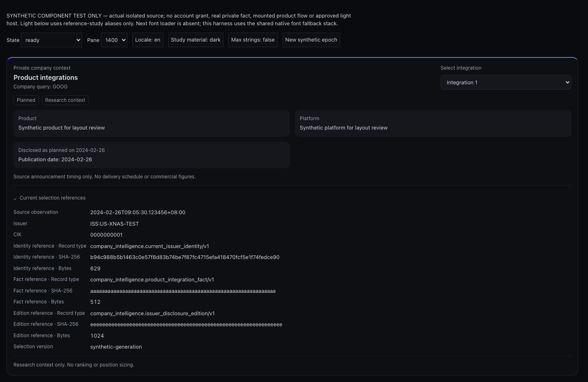
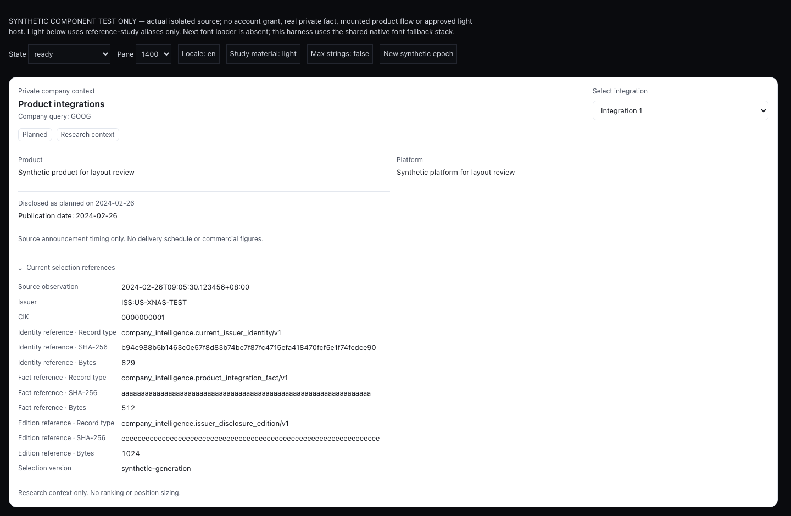
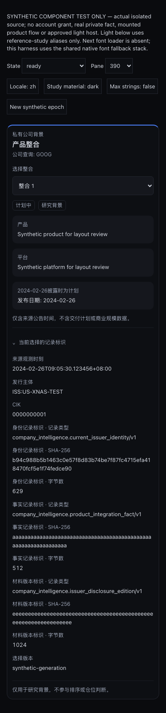
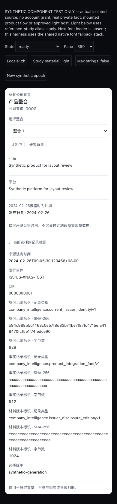
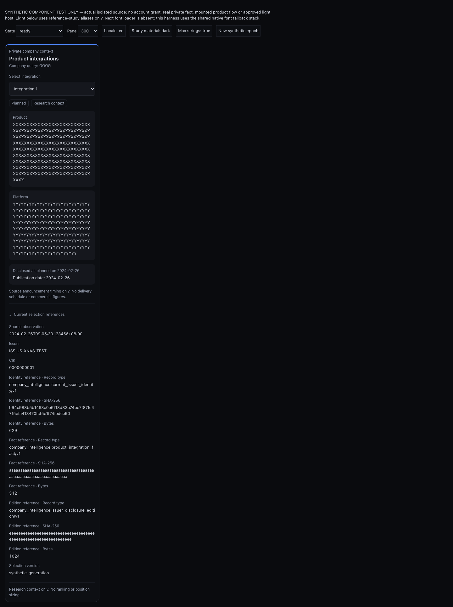
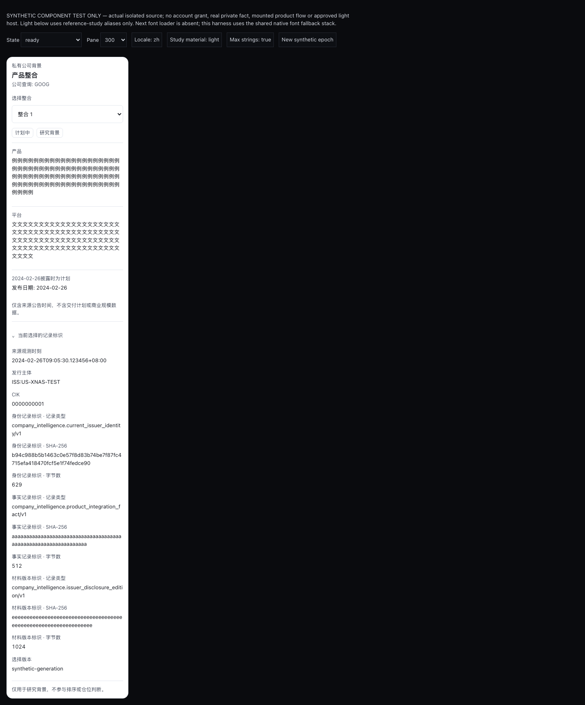
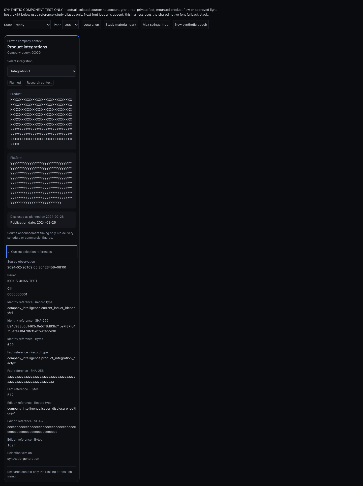

# Timing v2 — dated private disclosure evidence

These captures render the actual private Company Intelligence presenter with synthetic timing-v2 input. The main EN/ZH copy dates the planned disclosure as **2024-02-26**. Publication date and source observation are distinct; a date-only announcement has no invented publication instant. This qualifies the isolated display only.

All 232 focused tests pass (82 decoder, 55 route, 64 controller, 24 panel, 7 wrapper), with TypeScript and scoped ESLint exit 0. The source manifest binds the files to this capture. Browser checks passed 24 geometry cases, 132 transitions away from READY, 12 EN/ZH dated-disclosure assertions, preserved full hashes, and visible 2px keyboard focus.

## Dated disclosure on desktop and mobile

## Narrow panes and keyboard focus

All 25 captures and their hashes are retained in this directory. The earlier v1 captures remain unchanged in the parent directory. Reproduce with the parent harness build and qualification commands; its assertions now require the dated source disclosure.

The harness uses native font fallback without the Next font loader. Light uses reference-study aliases, not a production theme signal. There is no real host mount, private source read, or account lifecycle in this harness. Designated visual review, 200% zoom, actual host error reporting/theme behavior, and fresh incognito full-product acceptance remain open. The separately verified account grant does not turn synthetic inputs into source-backed product evidence.
