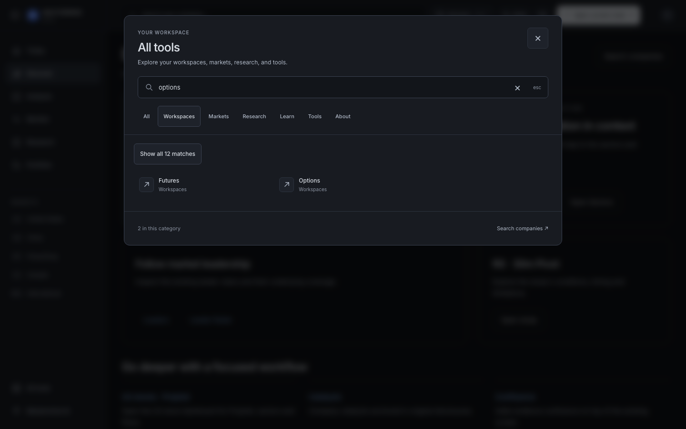
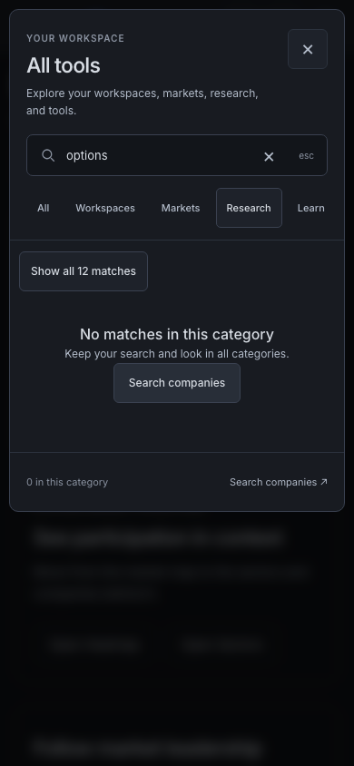

# F01 — directory recovery, focus and input hardening

**Implementation candidate, independent review pending.** This is the existing F01 receiver's bounded All tools change on protected Terminal `2ded360882b9c721e690907ff363b553781fb920`. The enclosing immutable commit binds code and evidence; nothing here claims merge, deployment, full shell acceptance or production proof.

## Problem and resulting behavior

The incumbent directory can report no pages when the selected category hides otherwise valid matches. Its count does not explain that scope. A removed recovery control or hidden desktop opener can lose keyboard focus; modified link activation closes the current directory even when navigation opens another tab. The changing result grid is a live region, and the old Close label lacks its intended translation.

The change makes scope and recovery explicit while retaining the actual matcher, seven categories, ranking, title owners, finite path fallback and exact href identities. It uses the existing component/copy/CSS owner. Query-wide, category and rendered counts are distinct. Show all changes only category; Clear search changes only query. Query/category edits reset48 in their event; close/reopen retains the mounted limit. The final Show more transfers focus to the first newly revealed result.

Close returns to a valid visible invoker or current visible shell/page fallback only when the directory still owns focus. Native company search replaces the directory through its existing parent callback, with no delayed second opener. Next Link onNavigate separates ordinary navigation intent from modified new-tab activation. An atomic, concise status replaces grid-wide announcements. Changed important controls use44px targets and the existing semantic palette; short viewports retain the input, Close and internally scrolling results.

Composition/repeat/child priority now governs both keydown and native cancel. Capture records ownership without canceling the IME's keydown; cancel consumes the association once; release, cleanup and an identity-guarded expiry retire it. Because cancel has no originating keyboard identity, a non-keyboard cancel arriving before expiry can conservatively consume an otherwise unconsumed protection once. Actual OS IME and other browser engines remain unqualified.

## Exact specification and ownership

- [F01 hardening source2d1c3e21](https://github.com/mastermindx-market-intelligence/macro/tree/2d1c3e21e58dd895b2282c6d6288e0eee4693c65/research/design_candidates/production_design_20261102/f01), especially [F01-CONFORMANCE/1.0.0-candidate.1](https://github.com/mastermindx-market-intelligence/macro/blob/2d1c3e21e58dd895b2282c6d6288e0eee4693c65/research/design_candidates/production_design_20261102/f01/INTERACTION_CONFORMANCE.md).
- Existing design carrier [Macro Draft#10645](https://github.com/mastermindx-market-intelligence/macro/pull/10645), receiver mastermidx4. Managed operation `f01-directory-hardening-20261104-c4`, branch `sol/web-f01-directory-hardening-20261104-c4`.
- F02's candidate.4 policy concurrence is bound to its e6c28413 handshake and historical semantic8926/blob1160f14. Neither concurrence nor source review5760649569 approves this implementation.
- [Terminal Draft#1244 at6fb8fd9](https://github.com/mastermindx-market-intelligence/mastermind-terminal/pull/1244) owns Market Intelligence navigation/title integration and unpublished CI/doc/registry work. Its native title mapping must survive integration; the query/category reset hunks overlap and require deliberate reconciliation. This branch does not replace that carrier or claim its features. [#1188](https://github.com/mastermindx-market-intelligence/mastermind-terminal/pull/1188) retains lazy/search-intent work; #1191 retains its LegacyPageHost scope.

The proposed Paper Options & futures facet remains with F03/domain qualification. Runtime keeps the incumbent Workspaces category: the inspected `options` query has12 all-category matches and2 Workspaces matches. `/options`, `/options.html`, `/options_screener.html` and `/options/futures` remain distinct. No directory registry, route, API, account/save/Brain lifecycle, symbol owner or persistence key is added. The passive dock→modal decision proposal is explicitly outside this implementation.

## Executed evidence

| Check | Actual result | Scope |
| --- | --- | --- |
| Original13 directory regressions on unchanged production source |13 failed /0 passed | Controlled component fixtures; corrected baseline locator retained in raw archive |
| Six later Escape regressions on the intermediate version |6 failed, then repaired | Native-event metadata, composition ending during dispatch, repeat, defensive child-consumed cancel, later non-keyboard close |
| Single-use cancel regression before final repair |1 failed, then repaired | A second independent request must not reuse consumed protection |
| Final unit/neighbor suite |84 passed /0 failed |21 directory cases plus63 presentation, contract, route-identity and region-navigation cases |
| Final actual Next browser cases |19 passed /0 failed /2 intentional skips /0 flaky | Chromium;1440×900,820×1180,390×844 plus320×420/844 stress; real AppShell, Directory, Link and company-picker handoff |
| Type check |exit0 | After the owned development server stopped; no generated type source edited |
| Scoped ESLint |exit0, zero warnings | Component, copy and both test files |
| Actual screenshot inspection | Representative hierarchy, clipping and focus states inspected | Three images below plus all15 final screenshots in raw archive; not complete visual/AT qualification |

[RESULTS.json](RESULTS.json) includes per-case statuses, exact source hashes and the unchanged-source diagnostic. [source-inputs-r4.json](source-inputs-r4.json) identifies every changed code/test input and package-lock. [ENVIRONMENT.json](ENVIRONMENT.json) records Node26.5.0, Next16.2.9, Vitest2.1.9, Playwright1.61.1 and Chromium149.0.7827.55 on the actual Mac arm64 runtime. Local Node26 required `NODE_OPTIONS=--no-experimental-webstorage` to avoid its native localStorage shadowing jsdom; no product/storage source was changed for that runtime issue. CI's Node20 execution remains separate.

The two skips are the tablet/mobile copies of the real modified-click/new-tab case; that case executes on desktop. The browser uses the repository's existing development identity cookies (`mm_e2e_rs30`, `mm_e2e_guest`) and a controlled AAPL company manifest. It is not a production account/data test. The trusted Escape case exercises Chromium cancellation with composition ending in a target listener; metadata229/isComposing/repeat and injected cancellation cases are labeled synthetic. Actual Chinese OS IME, assistive technology announcements, other engines, full magnification and all theme/locale/state combinations remain qualification obligations.

### Retained development issue

The browser is **not console/network clean**: Discover's generated dynamic-load manifest references missing `/_next/static/chunks/components_0jv6p3_._.js`. Clearing only this workspace's stopped-server development cache did not remove it. A bounded probe restored all three modified production files to exact protected2ded360, verified an empty production diff and reproduced the same404 on its second fresh-context visit. It then restored final file hashes exactly. [Actual baseline diagnostic](development-baseline-diagnostic.json) and raw reports preserve that distinction. No uncaught page error occurred in the final directory cases. This evidence establishes a pre-existing development issue; it does not establish its production behavior or repair it through F01.

The earlier concurrent type check saw an incomplete generated `.next/dev/types/routes.d.ts` while Next was starting. The final sequential check passes. Raw failures are retained rather than being rewritten as clean initial runs.

## Actual final captures






The category strip retains its incumbent contained horizontal overflow at narrow widths; it is not a claim that every category fits simultaneously. The browser exercises off-screen category controls through their actual layout. These captures are unedited bytes from the executed product fixture, verified against the raw manifest.

## Reproduction and evidence integrity

From `terminal/`, with the existing shared-shell development seam and installed dependencies:

```sh
NODE_OPTIONS=--no-experimental-webstorage npm test -- lib/__tests__/sharedShellDirectoryConformance.test.tsx lib/__tests__/sharedShellPublicPresentation.test.tsx lib/__tests__/sharedShellContracts.test.ts lib/__tests__/sharedShellRouteIdentity.test.ts lib/__tests__/sharedShellRegionNavigation.test.ts
NODE_OPTIONS=--no-experimental-webstorage TERMINAL_E2E_PORT=3139 MMX_SHARED_SHELL=1 TERMINAL_VISUAL_EVIDENCE_OPERATION=f01-directory-hardening-review npm run test:e2e:responsive -- e2e/shared-shell-directory-hardening.spec.ts --project=desktop --project=tablet --project=mobile --workers=1
./node_modules/.bin/tsc --noEmit --incremental false
./node_modules/.bin/eslint components/chrome/shared-shell/ShellDirectory.tsx lib/sharedShellCopy.ts lib/__tests__/sharedShellDirectoryConformance.test.tsx e2e/shared-shell-directory-hardening.spec.ts --max-warnings=0
```

Run type checking after the development server has stopped. [raw-evidence.zip](raw-evidence.zip) contains46 members: raw before/after reports, diagnostics, source inputs, all15 final screenshots and their manifest. SHA256: `abeeed2eccdb69a27962d1bbb848e2d0ac5863476f52d7919e7877b6aeece70b`. [raw-evidence-manifest.json](raw-evidence-manifest.json) supplies per-member hashes. The local managed worktree remains the original source/evidence carrier; the GitHub commit publishes the exact reviewed inputs without taking over adjacent worktrees.

## Review and rollback

Review exact matching/fallback equivalence, conditional focus, the one-use Escape association, real Next modified activation and #1244's overlapping reset/title integration. The full86 programme acceptance specifications remain NOT_RUN; these narrower passes do not qualify all their variants or the overall design. Original Paper effects, complete native/RIG/QA01 and domain lifecycle/return obligations remain open.

If this unmerged candidate is rejected, retire or amend this same source diff. No user data, route catalogue, storage migration, request identity or saved object needs rollback. Merge, Ready, un-draft, enqueue, held-PR relabel and deployment remain held by the current user instruction.
