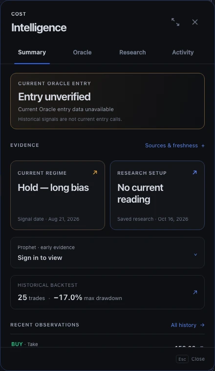

# Stock Intelligence R6 — Evidence Desk

This is the verified source candidate for the Chairman's further Intelligence redesign. It extends merged R5 PR #1252; it does not reuse that completed branch or create another chart/decision/data system.

## Actual product screenshots

These captures are from the real local Next.js Terminal route using explicit COST source fixtures. They are **not authenticated production, current AMZN data, or proof of deployment**. All captured input PNG hashes, output WebP hashes, dimensions and source-file digests are in `receipt.json`. The 25 WebP files total about650KB.

| View | English | Chinese |
| --- | --- | --- |
| Desktop Summary | [Open](desktop-summary-en.webp) | [Open](desktop-summary-zh.webp) |
| Desktop sources | [Open](desktop-overview-sources-en.webp) | [Open](desktop-overview-sources-zh.webp) |
| Desktop search | [Open](desktop-search-en.webp) | [Open](desktop-search-zh.webp) |
| Tablet Summary | [Open](tablet-summary-en.webp) | [Open](tablet-summary-zh.webp) |
| Tablet search | [Open](tablet-search-en.webp) | [Open](tablet-search-zh.webp) |
| Phone Summary | [Open](mobile-summary-en.webp) | [Open](mobile-summary-zh.webp) |
| Phone search | [Open](mobile-search-en.webp) | [Open](mobile-search-zh.webp) |
| 320px dark | [Open](mobile-320-dark-en.webp) | [Open](mobile-320-dark-zh.webp) |
| 320px light-token specimen | [Open](mobile-320-light-specimen-en.webp) | [Open](mobile-320-light-specimen-zh.webp) |
| 320px light search specimen | [Open](mobile-320-search-light-specimen-en.webp) | [Open](mobile-320-search-light-specimen-zh.webp) |

[Full desktop chart context](desktop-chart-context.webp). Terminal's production shell remains dark-only; the labeled light captures qualify the component's token behavior, not a newly shipped application theme. Finite theme transitions are fast-forwarded for those screenshots; normal drawer animation/reduced-motion behavior is separately tested.

## User-visible capability

A compact current-entry qualification precedes comparable Oracle/Research cards. Dates belong to their actual sources, not the fetch time. Prophet remains a separate permission-aware early-evidence read. An expandable Sources & freshness inspector exposes source state and explicit per-source refresh through the incumbent cache owner. Recent observations link to their original chart coordinates. Historical trade count and drawdown are labeled historical, not probabilities or a current recommendation.

Activity now supports literal, bounded English/Chinese search across displayed event meanings, ISO/display dates, source names and prices; matched-cohort category counts; newest/oldest order; explicit empty states; keyboard-clear focus; and synchronous symbol-change reset. Source object identity, observed-vs-chart timestamps, retrospective/refusal classifications and zero prices remain unchanged. Undated rows stay last in either sorting direction. Summary, search and timeline share one event-presentation helper.

## Design source

Paper file `01M3NSZGE8JWN2EZCSF0DT05RM`, page `p-I-1`, board **`1SNP-0`** (1040×900). The actual editable board contains a compact Summary and history-search specimen using dated AMZN observations. It was screenshotted, repaired for text contrast, re-inspected and its card JSX extracted before application integration. Editing completion was reconciled and returned APPLIED on the original Mastermind Paper carrier. R4/R5 boards remain unchanged reference anchors.

The application continues using its real existing chart. No schematic or sampled Paper price trace is substituted into production code.

## Verification

- **231 focused tests passed** across source projection, Activity, existing Oracle truth, verdicts, geometry, source-hook identity/recovery and the new overview's behavior. Zero/missing price, zero sample, untrusted text, refusal and retrospective meanings are covered.
- **36 browser checks passed, 12 expected device-specific skips, zero retries**, across the complete Intelligence suite plus Golden Oracle, HK-O1 refused-entry and retrospective-signal integration cases. Contract viewports:1440×900,820×1180,390×844, plus320px EN/ZH.
- The final 48-case run had a before/after SHA-256 guard proving the five executable/style/test input files did not change during that run. The stronger follow-up keyboard-to-chart checks passed6/6 across both languages and all three devices, including Escape, focus and mobile dismissal; they are recorded separately and do not inflate the distinct test count.
- TypeScript passed after the owned development server stopped and standard `next typegen` regenerated route types. One malformed **ignored generated** Next dev validator was quarantined in the operation cache; no application source, assertions or CI rules were weakened to obtain that result.
- The added-line plain-language guard and its self-check passed. The new component, Activity helper and changed test files have zero ESLint errors/warnings. Existing legacy OracleDash lint findings outside this change are not claimed fixed.

### Falsifiers found and repaired

The first compact Oracle card incorrectly used latest-marker quality and could omit the canonical warning about a newer refused entry. The unchanged HK-O1 test caught this in all viewports. The card now uses the existing `oraclePresentation` subtitle; an older accepted stop is not relabeled with the newer refusal's quality. Source dates are not redundantly repeated when that subtitle already contains them.

Clearing search initially removed the clear button without restoring keyboard focus. A failing browser assertion proved the defect before the input-refocus repair. A narrow-screen geometry test also compared two different animation frames; it now reads both rectangles atomically, preserving the original non-overlap assertion without sleep/reload/retry.

Synthetic local search samples improved from149.7ms to9.8ms at400 events and from1041.6ms to26.5ms at4000 events by reusing locale formatters and not formatting identical dates twice. These are **single synthetic local samples, not production latency guarantees**. No event-index store, source cache, signal engine or authority layer was added.

## Release and authority boundaries

This is source/local-browser proof. Current-head hosted CI, actual eligible independent non-author approval, protected integration/merge, git-gated deployment identity and authenticated production acceptance remain separate gates. The previous failed R4 Fabric run was not retried. An author's self-QA is SELF_REVIEWED, not formal independent APPROVED.

The current Terminal agent-guide clarification at `e48170b609dddf3b5b4eba1c047620d5d017290f` was read; its proposed risk-rule exemption is not treated as protected/enrolled. The source branch stays based on `f528a219cc5d73e94e058575e3df83d689632bf9` because the intervening change affects agent guides only and does not require an ancestry-only code update.

**Production acceptance remains false until the actual merged revision is deployed and the real authenticated journeys pass.**
